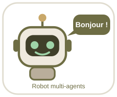

# 🤖 Mini-projet : architecture multi-agents par secteur

Six agents sectoriels (**mines, santé, automobile, finance, énergie, e-Gov**) + un **agent de monitoring**, orchestrés par une API FastAPI, avec correlation ID, Agent Cards, runbook, tests automatisés (GitHub Actions), Docker et déploiement Render. Option GitHub (désactivée par défaut).

> Les seuils métier sont **illustratifs** : à calibrer et valider par des experts. Les agents aident à décider : **validation humaine toujours requise**. Aucune donnée métier n'est journalisée.

## 🤖 Démarrage pas à pas (débutant, VS Code)
1. 🤖 Installez **VS Code** (code.visualstudio.com) et **Python 3.12** (python.org : cochez *Add Python to PATH*).
2. 🤖 Décompressez le projet, puis VS Code : **Fichier → Ouvrir le dossier…** → choisissez `multiagent-secteurs`.
3. 🤖 VS Code propose d'installer les extensions recommandées : cliquez **Installer**. Si une fenêtre demande d'autoriser la tâche automatique, cliquez **Autoriser** : le robot dit bonjour dans le terminal.
4. 🤖 **Parler au robot (aucune installation)** : menu **Terminal → Exécuter la tâche → 🤖 Parler au robot** (ou tapez `python robot.py`).
5. 🤖 **Installer les outils** (une seule fois), dans le terminal : `pip install -r requirements-dev.txt`
6. 🤖 **Tests** : tâche **🤖 Lancer les tests** (ou `python -m pytest -q`). Attendez : `passed`.
7. 🤖 **API** : tâche **🤖 Démarrer l'API**, puis ouvrez http://127.0.0.1:8001/docs (page interactive).
8. 🤖 **Docker** (si installé) : tâche **🤖 Docker : construire et lancer** après `cp .env.example .env`.

## 🤖 Mettre sur GitHub
1. github.com → **New repository** → nom `multiagent-secteurs`, **Private**, sans README.
2. Terminal VS Code : `git init`, `git add .`, `git commit -m "v1.0.0"`, `git branch -M main`, `git remote add origin https://github.com/VOTRE-NOM/multiagent-secteurs.git`, `git push -u origin main`.
3. L'onglet **Actions** lance automatiquement : tests → build Docker → test du conteneur → (déploiement si le secret existe).
4. Le sticker robot de ce README s'affiche sur la page GitHub.

## 🤖 Déployer sur Render
1. render.com → **New → Blueprint** → choisissez le dépôt (le fichier `render.yaml` configure tout).
2. Render génère `AGENT_API_KEY` et `ADMIN_TOKEN` (onglet *Environment*). Renseignez `OWNER_BUSINESS`.
3. Pour que la CI déploie : service Render → *Settings → Deploy Hook* → copiez l'URL → GitHub : *Settings → Secrets and variables → Actions* → secret `RENDER_DEPLOY_HOOK`.
4. Testez : `https://VOTRE-SERVICE.onrender.com/health`.

## 🤖 Option GitHub (synchronisation de la gouvernance)
Désactivée par défaut. Pour l'activer : jeton GitHub *fine-grained* (un seul dépôt **privé**, Contents : Read and write), puis variables `GITHUB_SYNC=1`, `GITHUB_TOKEN`, `GITHUB_REPO`. Le robot (menu 7) ou `POST /api/admin/github/sync` envoie : Agent Cards, audit (métadonnées) et métriques agrégées. **Jamais** les données métier.

## Critères de validation → où les vérifier
| Critère | Où | Preuve |
|---|---|---|
| Observabilité | `app/observability.py`, en-tête `X-Correlation-ID` | chaque réponse, audit et alerte portent un correlation ID ; `GET /api/monitoring` |
| Tests | `tests/`, CI | `pytest -q` ; onglet Actions vert |
| Gouvernance | `agent_cards/*.json`, `GET /api/governance/check` | 7 cartes complètes et à jour |
| Conteneurisation et déploiement | `Dockerfile`, `render.yaml` | `/health` sur l'URL Render |
| Incident | `docs/RUNBOOK.md`, kill switch | scénario joué dans la vidéo |
| Documentation + démo vidéo | `docs/DOCUMENTATION.md`, `docs/DEMO_VIDEO.md` | script de la vidéo |

## API
`GET /health` · `GET /api/agents` · `GET /api/agent-card/{id}` · `GET /api/governance/check` · `GET /api/runbook` · `POST /api/analyze/{secteur}` (`X-API-Key`) · `GET /api/monitoring` · `GET /api/audit` · `GET /api/audit/verify` · `POST /api/admin/kill-switch` · `POST /api/admin/github/sync` (`X-Admin-Token`).

Exemple : `curl -X POST http://127.0.0.1:8001/api/analyze/mines -H "Content-Type: application/json" -H "X-API-Key: VOTRE_CLE" -d '{"methane_ppm":300,"vibration_mm_s":3,"temperature_c":25}'`
