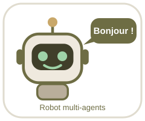

# 🤖 Votre robot dans VS Code

| Où | Ce que vous voyez |
|---|---|
| Barre de titre de la fenêtre | **🤖** devant le nom du projet |
| Terminal à l'ouverture | Le robot vous dit bonjour (tâche *🤖 Bienvenue*) |
| Terminal → Exécuter la tâche | Tâches *🤖 Parler au robot*, *🤖 Lancer les tests*, *🤖 Démarrer l'API*, *🤖 Docker* |
| Exécuter et déboguer | Configurations *🤖 API* et *🤖 Robot* |
| Cet écran | L'autocollant robot (aperçu Markdown ; `Ctrl+Shift+V` si besoin) |
| GitHub | Le même autocollant en haut du README |

Parler au robot : `python robot.py` : menu 1 analyse, 2 monitoring, 3 gouvernance, 4 audit, 5 incident, 6 tests, 7 GitHub (option), 8 simulation d'incident (démo).
