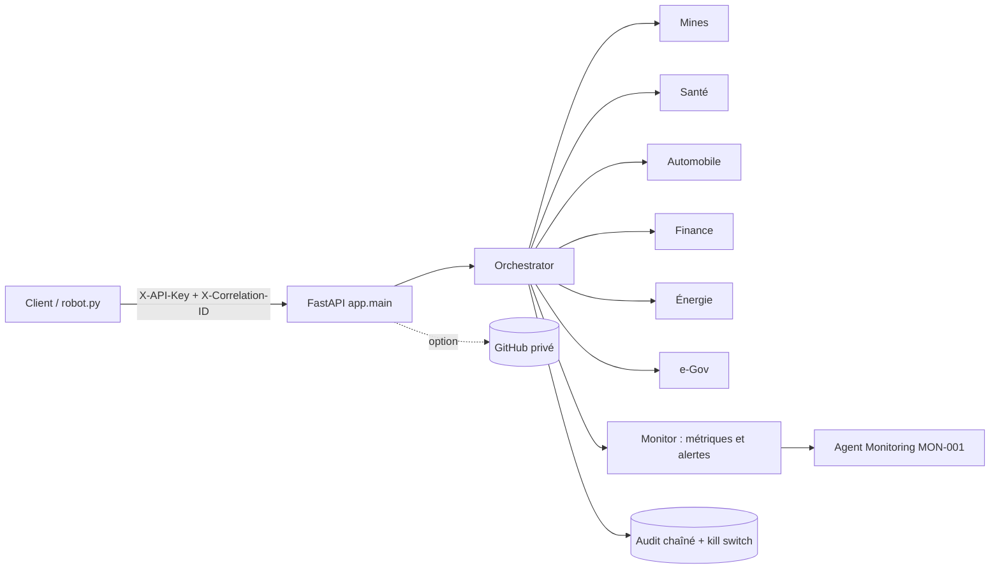

# Documentation technique

## 1. Architecture

- `app/agents.py` : 6 agents sectoriels (règles + validation d'entrée), agent de monitoring, orchestrateur.
- `app/observability.py` : correlation ID, Monitor (latence, erreurs, alertes), audit à chaîne de hachage, kill switch.
- `app/governance.py` : Agent Cards (complètes et à jour), runbook, génération des JSON.
- `app/main.py` : API REST. `app/github_sync.py` : option GitHub.

## 2. Déroulé d'une exécution
1. La requête arrive ; un `X-Correlation-ID` valide est conservé, sinon un identifiant `API-xxxxxxxx` est créé.
2. Authentification par clé d'API (comparaison à temps constant).
3. L'orchestrateur vérifie le kill switch, choisit l'agent du secteur, valide strictement l'entrée.
4. L'agent applique ses règles : score 0 à 100, niveau (faible, modéré, élevé, critique), raisons, recommandations. `requires_human_validation` est toujours vrai.
5. Le Monitor enregistre la latence et le statut (succès, refus, erreur) ; une alerte est créée si erreur ou latence > seuil (5 000 ms par défaut).
6. L'audit enregistre : événement, correlation ID, secteur, agent, statut, version. **Jamais** les données métier.

## 3. Secteurs (seuils illustratifs)
| Secteur | Entrées | Règles principales |
|---|---|---|
| Mines | méthane, vibrations, température | méthane ≥ 5000 ppm critique ; vibrations ≥ 20 mm/s |
| Santé | douleur, sommeil, signes d'alerte | signe d'alerte = orientation urgente ; aucun diagnostic |
| Automobile | température moteur, batterie, pneus, codes défaut | ≥ 110 °C ; < 11,8 V ; < 1,8 bar |
| Finance | montant, risque pays, vélocité, nouveau bénéficiaire | montant ≥ 10 000 ; risque pays ≥ 0,7 ; ≥ 10 opérations/24 h |
| Énergie | charge, fréquence, écart de tension | écart de fréquence ≥ 0,5 Hz ; charge ≥ 95 % |
| e-Gov | pièces, identité, cas sensible, similarité | identité non vérifiée ; cas sensible = étude humaine |

## 4. Agent de monitoring (MON-001)
Surveille taux d'erreur et latence de tous les agents. `ok` ; `degraded` (alertes ou erreurs ≥ 10 %) ; `critical` (≥ 5 exécutions et erreurs ≥ 30 %) avec recommandation d'activer le kill switch.

## 5. Gouvernance
Chaque agent a une Agent Card (`agent_cards/*.json`) : id, nom, version, rôle, propriétaire métier, responsable technique, outils, limites, garde-fous, prochaine revue. `GET /api/governance/check` indique si chaque carte est **complète** et **à jour** ; un test vérifie la synchronisation code/JSON. Versionnement SemVer par tags Git (`vX.Y.Z`) : Major = comportement, Minor = nouvelle capacité, Patch = correction. **À faire :** nommer le propriétaire métier (`OWNER_BUSINESS`).

## 6. Tests et CI/CD
- 27 tests : agents (normal, critique, entrées invalides, secteur inconnu, kill switch), observabilité (correlation ID, alertes, audit, altération détectée), gouvernance (cartes, runbook), API (clé, 401/404/422/503, option GitHub).
- GitHub Actions (`.github/workflows/ci.yml`) : tests → build Docker → démarrage du conteneur et `/health` → déploiement Render via Deploy Hook (si secret).

## 7. Conteneurisation et déploiement
Dockerfile (utilisateur non-root, healthcheck, `PORT` de Render), `docker-compose.yml` (volume pour l'audit), `render.yaml` (Blueprint, clés générées par Render). L'audit et les métriques vivent sur le disque du conteneur : sur l'offre gratuite de Render ils sont perdus au redémarrage (utiliser un disque persistant ou la synchronisation GitHub).

## 8. Sécurité
Secrets uniquement en variables d'environnement ; démarrage refusé si clés < 16 caractères ; entrées validées (types, plages, listes courtes) ; correlation ID filtré par expression régulière ; HTTPS fourni par Render ; moindre privilège pour le jeton GitHub (un dépôt privé). Pas de limitation de débit intégrée : à ajouter derrière un proxy en production.

## 9. Limites
Règles simples et seuils illustratifs (aucun modèle d'IA) ; métriques en mémoire ; aucune authentification d'utilisateurs finaux ; la conformité (secteurs réglementés, protection des données) doit être validée par des experts.
